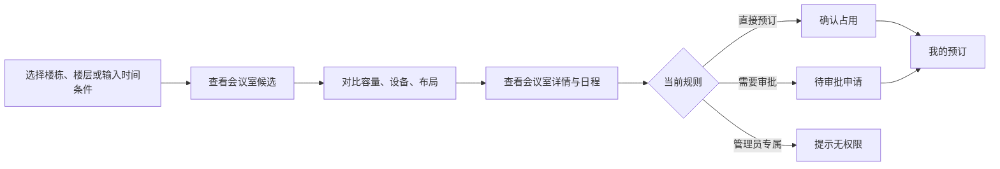

# 01 · 产品范围与原型设计（v0.1）

> 状态：讨论稿。仅确认先前沟通明确的需求，未确认项列为建议；请勿把建议视作已拍板。

## 1. 定位与设计目标

**间序（Spaceflow）**：企业空间资源发现、可视化档案与预订管理平台。一期聚焦会议室。

价值主张：用户先按日期时间与人数找空闲会议室，再看到直观的内部布局，确认适不适合自己的会议；管理员可独立维护空间与预订规则。不同于纯日历或会议组织系统，不管理参会名单、会议议程和会议邀请。

三个关键产品原则：① **空间发现优先**，不强迫用户先选会议室再查空闲；② **布局即档案**，布局用于理解空间，不代表椅子可逐个预订；③ **轻会议、重资源**，组织协同系统可以未来集成，但不进入一期。

## 2. 已确认范围

| 领域 | 决定 |
|---|---|
| 部署边界 | 独立运行；暂不对接既有 OA / Outlook 等系统，未来预留接口 |
| 空间层级 | 楼栋 → 楼层 → 会议室；一期不做整层楼地图 |
| 室内布局 | 管理员拖拽编辑桌椅、门窗、设备；示意关系为主，无 CAD 比例尺 |
| 预订用途 | 仅管理会议室资源，无参会者管理 |
| 预订规则 | 按会议室配置直接生效 / 审批 / 仅管理员预订 |
| 周期性预订 | 按会议室配置是否开放；重复和例外规则待细化 |
| 权限 | 可见与可预订两条独立权限；默认所有人可见且可预订 |
| 身份来源 | 本地账号和部门，预留 SSO 与组织架构同步适配 |
| 隐私 | 主题、联系人、联系方式默认可见；预订者可隐藏 |
| 状态管理 | 启用、禁用、隐藏、维护状态需要独立语义 |

## 3. 用户旅程

### 用户端信息架构

- **空间发现**：位置筛选、时间筛选、容量、投屏/视频/白板等设施；列表/卡片型结果；空闲与冲突提示。可用时段必须由服务端计算。
- **会议室详情**：容量、楼栋楼层、面积、设施、照片、布局示意图、预订规则与开放状态、当天占用记录。用户端布局只读。
- **预订日程**：按会议室和日期查看占用；资源时间轴作为独立视图，而不是初期所有交互的唯一入口。
- **创建预订**：主题、开始/结束时间、联系人、联系方式、可选备注、是否隐藏信息。审批中需明显标识。
- **我的预订**：我发起的申请/已确认/已取消；修改与取消策略待详细设计。

### 管理端信息架构

- **空间管理**：楼栋、楼层、会议室档案；图文说明、设备、容量、布局类型、标签。
- **内部布局编辑器**：组件面板、二维画布、属性面板；模板、拖拽、移动、旋转、复制/删除、撤销和保存。
- **预订策略**：直接预订/审批/仅管理员、周期性开关、时长/提前预订范围等建议项。
- **权限**：用户、部门、角色；会议室级可见与可订分离；细粒度优先级待确认。
- **预订处理**：审批、取消、代订、维护占用、历史记录；需有不可抵赖的操作审计。

## 4. 四个高优先级页面及验收关注点

| 页面 | 用户关键动作 | 评审标准 |
|---|---|---|
| 空间发现 | 选楼栋、楼层、时间、人数、设备 | 30 秒内找到合适会议室，时段/容量/设施逻辑可理解 |
| 会议室详情 | 看布局与设施、确认占用 | 门窗、桌椅、投屏位置清楚；对隐私和规则提示明确 |
| 预订日程 | 对比时间与会议室，开始预订 | 能分辨空闲、占用与审批占位，能避开冲突 |
| 布局编辑器 | 从组件库拖/点入、调整、保存 | 非专业管理员也能维护示意布局，重新打开不丢数据 |

用户端应优先支持桌面浏览器；移动端适配和触摸画布编辑需要单独验证，不默认列为一期必须交付。

## 5. 主要实体（业务语义，不是数据库设计）

`Building`（楼栋）→ `Floor`（楼层）→ `Space`（空间/资源）；`Space` 挂设备和一份或多份版本化 `Layout`（会议室内部图）；`Space` 挂一组 `BookingPolicy`；`ReservationSeries` 展开为 `ReservationOccurrence`（可审批、可单次取消）；`SpaceAccessPolicy` 把“是否能看”与“是否能订”分开。

会议室与工位都是 `Space` 的不同 `space_type`，但不强制它们共用预订状态机或业务字段：工位可引入席位属性、个人分配、每日座席等专项模型。

## 6. 一期与非一期

**一期建议纳入**：资源管理、筛选、布局、单次预订、审批闭环、周期性预订、隐私、组织/权限、管理员调度、操作审计。状态类系统必须可追溯，而非只做视觉上成功。

**暂不纳入**：整层平面图、工位管理、CAD 测绘、会议邀请/参会者日历、签到门禁、智能硬件、收费、智能推荐、跨系统双向日历同步。

## 7. 尚待详细设计确认

1. 审批占位期限：建议审批中的时段临时占位，过期自动释放。
2. 周期申请的部分冲突：建议先给出所有冲突明细，允许只申请无冲突项。
3. 变更影响：禁用、隐藏、维护是否通知已预订用户；建议不自动删除历史记录。
4. 隐藏信息具体粒度：当前约定隐藏主题/联系人/联系方式，时段占用始终可见。
5. 访问控制冲突：部门和个人的 allow/deny 优先级、管理员豁免、租户隔离。
6. 附加运营功能：照片、电子邮件通知、导入导出、数据统计的优先级。

## 8. 原型边界

[`../prototype/index.html`](../prototype/index.html) 是无后端设计验证原型，包含示例身份与演示数据。其时间冲突检查为浏览器级模拟，**不支持真实并发、周期展开、审批执行、用户权限和企业 SSO**；应按功能矩阵评审交互，不按原型判断服务端需求已经实现。
